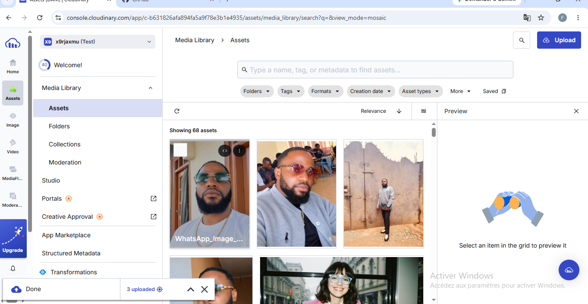

# Regards — Galerie Cloudinary

Une petite galerie photo responsive qui affiche quatre images hébergées sur **Cloudinary**. Sélectionnez une photo pour l’ouvrir dans la visionneuse : son URL publique y est affichée, avec des actions pour copier, télécharger ou partager l’image.

## Liens de livraison

- **Dépôt GitHub :** à compléter après la création du dépôt.
- **Site publié :** à compléter après le déploiement.

## Aperçu de la bibliothèque Cloudinary

La capture ci-dessous montre la bibliothèque média Cloudinary utilisée pour le TP. Cliquez dessus pour afficher la capture en taille réelle.

Tous les fichiers du projet, y compris cette capture, sont directement à la racine. Il n’y a aucun sous-dossier à déplacer lors de l’envoi manuel sur GitHub.

## Technologies utilisées

- HTML5 pour la structure sémantique ;
- CSS3 pour la mise en page responsive et les styles ;
- JavaScript natif pour la galerie, la visionneuse et ses actions ;
- Cloudinary pour héberger et diffuser les images.

Le projet ne dépend d’aucun framework ni paquet à installer.

## Utilisation de Cloudinary

Les quatre photos sont chargées directement depuis leurs URL publiques Cloudinary, dans `script.js`. Elles ne sont pas stockées dans le dépôt. La visionneuse affiche l’URL de diffusion originale ; le bouton de téléchargement utilise le paramètre de livraison `fl_attachment` de Cloudinary.

Cette galerie ne réalise que de la **lecture** d’images publiques. Elle n’utilise ni téléversement depuis le navigateur, ni clé API, ni `API secret` : aucun secret Cloudinary ne doit être ajouté au code ou au dépôt GitHub.

Pour remplacer ou ajouter une photo :

1. Téléversez une image que vous avez le droit de publier dans votre bibliothèque Cloudinary.
2. Copiez son URL de livraison publique.
3. Dans `script.js`, ajoutez une entrée à `photos` avec un titre, une courte description, un texte alternatif et cette URL.
4. Vérifiez que l’image est accessible sans connexion dans une fenêtre privée.

## Lancer le projet en local

1. Téléchargez ou clonez le dépôt.
2. Ouvrez `index.html` dans un navigateur. Aucun build n’est nécessaire.
3. Pour une expérience plus proche du site publié, ouvrez le dossier dans Visual Studio Code et lancez-le avec l’extension **Live Server**.

La copie d’URL utilise le presse-papiers lorsqu’il est disponible ; sinon, l’URL reste sélectionnée dans la visionneuse afin de pouvoir la copier manuellement. Le partage natif dépend du navigateur et de l’appareil.

## Publier gratuitement

### GitHub Pages

1. Créez un dépôt GitHub.
2. Dans le dépôt, choisissez **Add file → Upload files**.
3. Depuis le dossier du projet, sélectionnez les fichiers à la racine (`index.html`, `styles.css`, `script.js`, `README.md` et `cloudinary-media-library.png`), puis validez avec **Commit changes**.
4. Ouvrez **Settings → Pages** dans le dépôt.
5. Choisissez **Deploy from a branch**, sélectionnez `main` et le dossier `/ (root)`, puis enregistrez.
6. Une fois le déploiement terminé, copiez l’URL fournie par GitHub Pages dans la section [Liens de livraison](#liens-de-livraison) ci-dessus.

Le dépôt doit contenir `index.html` à sa racine. Vercel ou un autre hébergeur statique gratuit peut également publier directement ce dossier.

## Vérifications

- Quatre images sont affichées depuis les URL Cloudinary fournies.
- La mise en page s’adapte aux différentes tailles d’écran : trois colonnes sur grand écran, deux sur tablette et une sur téléphone.
- Chaque image ouvre une visionneuse avec son URL, le téléchargement, le partage et la copie du lien.
- Aucun secret d’API Cloudinary n’est exposé.
